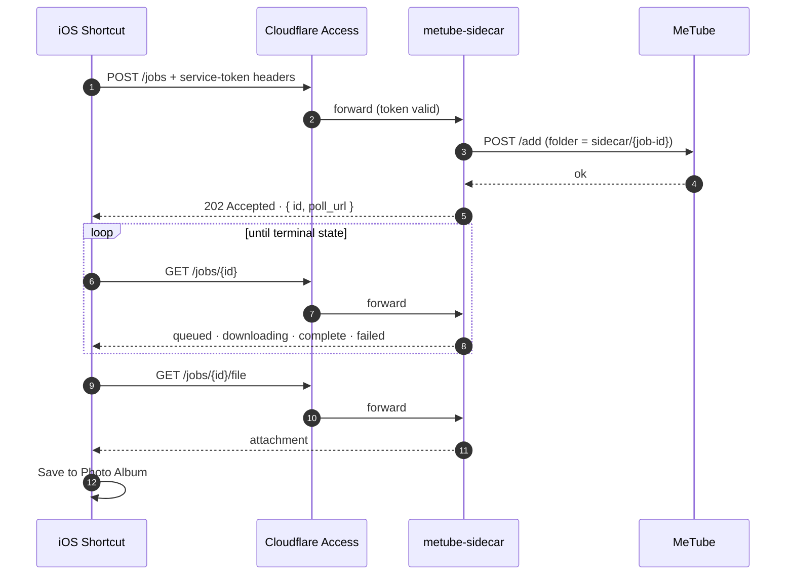

<div align="center">

# ⬇️ metube-sidecar

**Turn a MeTube download into a pollable job — and hand the finished file
straight back to an authorized caller.**

A tiny FastAPI service that gives [MeTube](https://github.com/alexta69/metube)
the missing piece: a clean job API your phone, scripts, and automations can
talk to. Built for the *iOS Shortcut* flow — share a video link, wait a
moment, save it to Photos. Authentication happens at the edge with
**Cloudflare Access**; this service never sees or stores credentials.

[](https://github.com/alexta69/metube)
[](https://www.python.org/)
[](https://fastapi.tiangolo.com/)
[](#quick-start)
[](#development)

</div>

---

## Background

### What is MeTube?

[MeTube](https://github.com/alexta69/metube) is a widely used, self-hosted
web front end for [yt-dlp](https://github.com/yt-dlp/yt-dlp). Deployed as a
single container, it lets anyone on your network paste a video URL from
YouTube and thousands of other supported sites, pick a format and quality,
and watch the download progress in the browser.

It is excellent at exactly one thing: **being a nice website for humans.**

### The problem

The moment you try to automate MeTube, you hit a wall:

- Its `/add` endpoint is **internal and undocumented**, and calls are
  fire-and-forget — you get an acknowledgment, not a job.
- There is **no public API to query a download's status** or to fetch the
  finished file over HTTP. Results simply appear in a folder on disk.
- Exposing MeTube itself to the internet so an app can reach it would put a
  browser-oriented tool on the public edge — not something you want to
  authenticate against from an iPhone.

So if your goal is *"share a link on my phone → the video lands in my photo
library"*, stock MeTube gets you none of the way there.

### Where this sidecar fits

`metube-sidecar` is a small companion service that runs **next to** MeTube
(never instead of it) and adds the missing automation surface:

| Capability | Direct to MeTube | Via metube-sidecar |
|---|:---:|:---:|
| Submit a URL programmatically | ⚠️ undocumented internals | ✅ `POST /jobs` |
| Pollable per-job status (`queued → complete`) | ❌ | ✅ `GET /jobs/{id}` |
| Download the result over HTTP as an attachment | ❌ | ✅ `GET /jobs/{id}/file` |
| Edge-authenticated access from anywhere | — | ✅ Cloudflare Access |
| Survives restarts, keeps state on disk | — | ✅ persisted metadata |

Because it observes MeTube through a **read-only mount** of the same
download directory, the sidecar needs zero patches to MeTube — upgrade either
one independently. And because it stays behind a Cloudflare Tunnel with
Access **Service Auth**, your downloader becomes reachable only by callers
holding the right token: a private, self-hosted answer to the shady
"free video downloader" apps and websites out there.

## What it does

The sidecar wraps MeTube's internal `/add` endpoint in a small job API:

- **Submit** a URL and get a job ID back immediately (`202 Accepted`).
- **Poll** the job until its status flips to `complete`.
- **Fetch** the finished file as an HTTP attachment and pipe it into Photos.
- **Survive restarts**: job metadata lives in a persistent volume;
  downloaded files remain managed by MeTube.
- **Stay quiet**: submitted source URLs are deliberately never written to
  job metadata.

## How it works



1. `POST /jobs` validates the URL, reserves a unique MeTube folder
   (`sidecar/<job-id>`), persists the job, and forwards the request to
   MeTube's `/add`.
2. `GET /jobs/<job-id>` watches that folder through a **read-only** mount of
   MeTube's download directory and advances the job state.
3. A job becomes `complete` only once temporary download artifacts
   (`.part`, `.ytdl`, `.aria2`, …) are gone **and** the selected output file
   has stayed unchanged for `STABLE_SECONDS`.
4. `GET /jobs/<job-id>/file` streams the result back as an attachment, after
   a resolved-path containment check guarantees the stored relative path can
   never escape the job folder.

### Job lifecycle

| Status | Meaning |
|---|---|
| `queued` | Submitted to MeTube; nothing visible in the job folder yet |
| `downloading` | Files are appearing or changing in the job folder |
| `complete` | Output stable for `STABLE_SECONDS`; `file_url` is available |
| `failed` | Submission rejected or job timed out; see `error` |

Every response carries ready-to-use `poll_url` and `file_url` links, so the
caller never has to construct paths itself.

## Quick start

### Prerequisites

- A running [MeTube](https://github.com/alexta69/metube) instance.
- A shared Docker network between MeTube and this sidecar.
- The exact same host download directory that MeTube mounts at `/downloads`.
- A Cloudflare Tunnel with Access, for exposing the API publicly.

### 1. Run the container

Add the sidecar service to the same Compose project as MeTube, or copy
[`docker-compose.example.yml`](docker-compose.example.yml) standalone. Replace
`/path/to/metube/downloads` with the host directory mounted into MeTube. If
both services live in one Compose file, remove `external: true` and let
Compose create the network.

```bash
docker compose up -d --build
docker compose logs -f metube-sidecar
```

> [!IMPORTANT]
> The example uses `expose`, keeping port 8080 internal to connected
> containers. Do not publish it to the host or LAN; public reachability
> should come exclusively through the tunnel.

> [!NOTE]
> The application assumes a single Uvicorn worker. Its in-process lock is
> not a distributed lock — do not enable multiple workers without
> redesigning state coordination.

### 2. Expose it through Cloudflare Tunnel + Access

Create a dedicated hostname such as `download-api.example.com` on your
existing Cloudflare Tunnel, pointing at:

```text
http://metube-sidecar:8080
```

Then create a Cloudflare Access self-hosted application for that hostname
with a token policy of:

- Action: **Service Auth**
- Include: **Service Token** → the token dedicated to this Shortcut

Do **not** use an `Allow` action for a service-token-only policy.

> [!WARNING]
> Keep the service-token ID and secret only in the iOS Shortcut (or another
> secret store) — never in Git, Compose, or the sidecar itself.

## Configuration

| Variable | Default | Purpose |
|---|---:|---|
| `METUBE_URL` | `http://metube:8081` | Internal MeTube base URL |
| `DOWNLOADS_DIR` | `/downloads` | Read-only view of MeTube downloads |
| `DATA_DIR` | `/data` | Persistent job metadata (use the named volume) |
| `JOB_SUBDIR` | `sidecar` | Folder reserved for sidecar jobs |
| `STABLE_SECONDS` | `5` | Time an output file must remain unchanged |
| `JOB_TIMEOUT_SECONDS` | `3600` | Time before an unfinished job fails |
| `METUBE_TIMEOUT_SECONDS` | `20` | Timeout when submitting to MeTube |
| `SIDECAR_API_KEY` | unset | Optional second authentication layer |

If `SIDECAR_API_KEY` is set, every `/jobs` request must also carry
`X-Sidecar-Api-Key`. Cloudflare Access remains the primary control; this is
defense in depth.

## API reference

| Method | Endpoint | Description |
|---|---|---|
| `GET` | `/healthz` | Liveness probe (unauthenticated in-app for orchestrators; still gated by Access externally) |
| `POST` | `/jobs` | Validate a URL, create a job, submit it to MeTube → `202` |
| `GET` | `/jobs/{id}` | Refresh and return the current job state |
| `GET` | `/jobs/{id}/file` | Return the completed output as an attachment |

Interactive OpenAPI docs are served automatically at `/docs`.

### Submitting a job

```bash
export CF_ID='your-client-id.access'
export CF_SECRET='your-client-secret'

curl -sS -X POST 'https://download-api.example.com/jobs' \
  -H "CF-Access-Client-Id: ${CF_ID}" \
  -H "CF-Access-Client-Secret: ${CF_SECRET}" \
  -H 'Content-Type: application/json' \
  --data '{"url":"https://www.youtube.com/watch?v=JsdjnlsSaw4"}'
```

The response resembles:

```json
{
  "id": "48b49c4e-676e-45a8-95aa-0cfb1f26780a",
  "status": "queued",
  "poll_url": "/jobs/48b49c4e-676e-45a8-95aa-0cfb1f26780a",
  "file_url": null
}
```

Poll `poll_url` until `status` becomes `complete`, then request `file_url`
with the same Cloudflare headers.

<details>
<summary><strong>Compatibility with Shortcuts that posted directly to MeTube</strong></summary>

`POST /jobs` also accepts the legacy option shape used by Shortcuts that
previously posted to MeTube's `/add` endpoint directly. When `quality`,
`format`, or `video_codec` is supplied without `download_type`, the sidecar
forwards those values using MeTube's legacy schema and adds only its
controlled per-job folder:

```json
{
  "url": "https://example.com/video",
  "quality": "best_ios",
  "format": "mp4",
  "video_codec": "h264"
}
```

For compatibility with existing sidecar-oriented Shortcuts, `codec` in a
legacy-shaped body is translated to MeTube's legacy `video_codec` field.
Requests that explicitly provide `download_type` continue to use MeTube's
current schema. Omitted legacy fields and URL-only requests default to
`format=ios`, `codec=h264`, and `quality=best`.

</details>

## iOS Shortcut flow

Use the remote sidecar address as `server_address`, without a trailing slash.

1. **Get Contents of URL**: `server_address/jobs`
   - Method: `POST`
   - Headers: `CF-Access-Client-Id`, `CF-Access-Client-Secret`,
     `Content-Type: application/json`
   - JSON body: `url` = the shared video URL. Defaults are `format=ios`,
     `codec=h264`, and `quality=best`; existing direct-MeTube `quality`,
     `format`, and `video_codec` selections can be retained unchanged.
2. Get dictionary value `id` from the response and store it as `job_id`.
3. Repeat up to 120 times:
   - Wait 5 seconds.
   - GET `server_address/jobs/job_id`, including both Cloudflare headers.
   - If `status` is `complete`, GET `server_address` + `file_url`, again with
     both Cloudflare headers.
   - Pass the result to **Save to Photo Album**, show a success notification,
     and stop the Shortcut.
   - If `status` is `failed`, show `error` and stop the Shortcut.
4. If the loop finishes, show a timeout notification.

> [!TIP]
> Every HTTP action needs the Cloudflare headers — authentication is not
> carried over from the first request. iOS may ask for Photos permission the
> first time the Shortcut runs.

## Security model

- **Edge authentication first.** Cloudflare Access validates service-token
  headers before traffic reaches the sidecar, which neither proxies nor
  persists them.
- **Optional second layer.** `SIDECAR_API_KEY` adds a constant-time-checked
  `X-Sidecar-Api-Key` requirement on top of Access.
- **Read-only downloads.** The sidecar mounts MeTube's download directory
  `ro`, so it cannot modify MeTube's files.
- **Path containment.** The file endpoint resolves stored paths and rejects
  anything escaping the job folder.
- **Internal by default.** Container port stays on `expose`; only the tunnel
  reaches it.
- **Minimal metadata.** Source URLs are never persisted in job records.
- **Revocable access.** Give the Shortcut a dedicated service token you can
  rotate independently.

Download folders are not automatically deleted — apply your normal retention
or cleanup policy to MeTube's `sidecar/` directory.

## Development

Requires Python 3.12+.

```bash
python -m pip install -e ".[dev]"
python -m pytest -q
docker compose -f docker-compose.example.yml config --quiet
```

Tests cover API behavior, persistence, authentication, path safety, and
download detection. When changing the API, keep the tests, this README, and
the Compose example synchronized.

## Acknowledgements

- [MeTube](https://github.com/alexta69/metube) — the downloader this sidecar complements.
- [yt-dlp](https://github.com/yt-dlp/yt-dlp) — the engine doing the actual downloading.
- [FastAPI](https://fastapi.tiangolo.com/) and [Cloudflare Access](https://developers.cloudflare.com/cloudflare-one/access-control/) — the plumbing and the perimeter.
